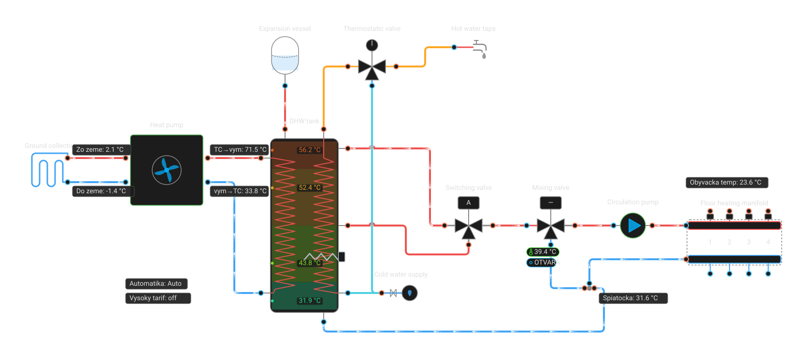

# Heating Visualizer Card

Custom Lovelace card for Home Assistant **2026.9+**. Draw your heating system from devices and pipes and see it live: temperatures, running pumps, valve positions, defrosting, alarms.



- **Visual editor** – add devices from a list, straight from an entity, or from a template; the editor suggests add-ons from the same Home Assistant device.
- **Add-ons** describe parts of a physical device (tank sensors, backup heater, defrost, …), no matter which integration provides the entity.
- **Heat pump detail** – a look inside the unit: animated refrigerant circuit, evaporator and compressor with all temperatures, pressures, power and COP; pinned in a corner of the card and/or opened by tap.
- **Right-angled pipes** (or curved), automatic arrangement in flow direction, drawing mode with drag & drop.
- **Actions** – tap, hold and double tap use the standard Home Assistant actions (more info, toggle, navigate, …).
- Follows the Home Assistant language and number formatting; keyboard and screen reader friendly; masonry and sections dashboards.

## Installation

### HACS (recommended)

1. HACS → ⋮ → **Custom repositories** → add `https://github.com/vasicekmilan90-eng/heating_vizualizer`, category **Dashboard**.
2. Install **Heating Visualizer Card** and reload the browser.

### Manual

1. Copy `heating-visualizer-card.js` to `<config>/www/`.
2. Settings → Dashboards → ⋮ → **Resources** → add `/local/heating-visualizer-card.js` as **JavaScript module**.

## Using the editor

Add the card from the card picker (**Heating Visualizer**).

**Schema tab – device list**

- *Add device* by type, *Insert template* (heat pump + floor heating, heat pump + DHW tank + floor heating, heat pump + buffer tank + radiators, boiler + radiators) or *Add from entity* – pick the main entity and the device type is suggested.
- *Arrange automatically* places devices in columns from the heat source along the pipes; *Undo arrangement* restores the previous positions.
- *Drawing mode* (✎) enables dragging devices and connecting two ports by clicking them. Without it the preview only selects, so scrolling on a phone never moves anything. Arrow keys move the selected device (Shift = faster). All ports lie on the 10-point grid devices snap to, so pipes between aligned ports run straight.
- **Pipe routing** – select a pipe in drawing mode and drag the squares on its segments; bends are added as needed. *Automatic routing* restores the computed path. Where pipes cross, the horizontal one jumps over the vertical one with a small arc.

**Device detail** (click a device row)

- Name, *Home Assistant device* (where the entities come from, e.g. the heat pump integration) and the optional *state entity*. The state entity makes the device green/animated while running and opens on tap; devices without an entity of their own (a DHW tank whose sensors belong to the heat pump) leave it empty and show activity through their pumps, fans and heaters. Heat pumps also offer *Variant* (monoblock / split) and *Pinned detail*.
- *Add-ons* – only the types the device supports, with the number still available. *Suggested add-ons* lists other entities of the same Home Assistant device with a guessed type and position.
- *Connections* per port – remove with ×, add with *Connect to…* (only compatible ports are offered).
- *Actions*, position (X/Y, arrows, rotate) and *Delete device*.

**Overlays tab** – value labels anywhere on the schema with a template, conditional colors/visibility and actions.

## YAML

```yaml
type: custom:heating-visualizer-card
schema_version: 2
nodes:
  - id: hp
    type: heat_pump
    name: Heat pump
    position: { x: 40, y: 60 }
    entity_id: climate.heat_pump
    hold_action:
      action: navigate
      navigation_path: /lovelace/heating
    addons:
      - type: temperature
        slot: outdoor
        entity_id: sensor.heat_pump_outdoor_temperature
      - type: defrost
        entity_id: binary_sensor.heat_pump_defrost
      - type: electric_heater
        entity_id: switch.heat_pump_backup_heater
  - id: tank
    type: tank
    volume: 200
    position: { x: 300, y: 20 }
    addons:
      # Coil heated by the heat pump, hot water for the house.
      - type: heat_exchanger
      - type: dhw
      # Wired to the heat pump, but physically part of the tank.
      - type: temperature
        slot: top
        entity_id: sensor.heat_pump_tank_top
      - type: electric_heater
        entity_id: switch.heat_pump_tank_heater
connections:
  - { from: hp.hot_out, to: tank.coil_in }
  - { from: tank.coil_out, to: hp.cold_in }
overlays:
  - id: o1
    entity_id: sensor.outdoor_temperature
    position: { x: 40, y: 0 }
    rules:
      - condition: numeric
        below: 0
        effect: { color: blue }
```

### Card options

| Option | Description |
| --- | --- |
| `nodes` | Devices: `id`, `type`, `position`, optional `name`, `device_id` (Home Assistant device), `rotation` (90° steps), `volume` (tanks, liters), `variant` (junction: `split` or `merge`; heat pump: `monoblock` or `split`), `detail_pin` (heat pump, see below), entity binding, `addons`, actions. |
| `connections` | Pipes from an outlet to an inlet, written as `node_id.port_id`; optional `route` with the bend points drawn in the editor, e.g. `[[240, 110], [240, 300]]`. |
| `overlays` | Value labels: `entity_id`, `position`, optional `name`, `template`, `rules`, actions. |
| `pipe_style` | `orthogonal` (default) or `curved`. |
| `pipe_colors` | Color pipes by what flows in them: heating supply red, return blue, hot water orange, cold water turquoise (default `true`). Pumps, valves and junctions take the color of their pipes. |
| `flow_animation` | Animate water in pipes that currently flow (default `true`): from running pumps and heat sources along the pipes, only through the active branch of 3-way valves, open zone valves and open manifold loops. An open hot water tap makes the cold water supply flow. |
| `schema_version` | Written by the editor. Configurations of 0.3 (`schema:` with `edges`, `channels`, `heater`) are converted automatically when loaded, and so are the `boiler` and `buffer_tank` of 0.4 (they become a `tank` with modules, pipes keep working). |

### Entity binding (devices and add-ons)

| Field | Meaning |
| --- | --- |
| `entity_id` | Bound entity. |
| `active_state` | State that means "running". Without it the device is active when `hvac_action` is `heating`/`preheating`, otherwise when the state is `on`, `heat` or `open`. On/off add-ons bound to a number (rpm, W, %) run while it is above zero. |
| `value_attribute` | Attribute shown instead of the state, e.g. `current_temperature`. |
| `mode_attribute` | 3-way valve: attribute with the branch position (default `position`). Mixing valve and actuators: attribute with the opening in % (default `current_position`, then the state). |
| `branch_a_value` / `branch_b_value` | 3-way valve: values for branch A / B (default `a` / `b`). |

### Add-ons

Each add-on has a `type`, optional `slot` (position on the drawing), `name` and the entity binding above. Loops also accept `temperature_entity_id` (room temperature). `hidden: true` keeps an add-on out of the schema (its badge, or a heat pump value line or backup heater) – the editor offers it as *Show in the schema*; the heat pump detail still shows everything. `hide_cop: true` on a heat pump drops the computed COP line from the outdoor unit.

| Type | Shown as |
| --- | --- |
| `temperature` | value colored from blue to red |
| `value` | any value (power, pressure, flow, COP, …); heat pump values can take a slot so the detail and the COP know what they are |
| `electric_heater`, `pump`, `fan`, `defrost`, `alarm`, `window` | on/off indicator; a heat pump fan bound to rpm or % spins at a matching speed (rpm shown at a tenth) |
| `actuator` | opening in % |
| `mode` | state text |
| `compressor` | heat pump compressor: on/off, or its frequency (running above zero) |
| `operation` | heat pump operating status. Slot `status`: a text (`Heating`, `DHW`, `Defrost`, `Idle`, … in English, Czech or German) or a climate entity's `hvac_action`; slots `heating`, `dhw`, `cooling`: on/off entities of one mode |
| `setpoint` | value |
| `heat_exchanger` | no entity – heat exchanger coil with `coil_in` / `coil_out` (a second one adds `coil2_in` / `coil2_out`) |
| `direct_source` | no entity – tank connection from/to the heat source: `source_in`, `source_out` |
| `direct_heating` | no entity – tank connection to/from the heating system: `supply_out`, `return_in` |
| `dhw` | no entity – domestic hot water: `cold_in`, `hot_out` |
| `circulation` | no entity – hot water circulation return: `circulation_in` |
| `loop` | manifold loop with actuator; each loop adds `loop_<n>_out` / `loop_<n>_in` ports |

Tank sensors (colored water), coils and immersion heaters, heat pump values, fan, defrost and backup heaters, and manifold loops are drawn inside the device; other add-ons appear as badges below it. Tapping a badge opens more info of its entity. A device without its own state entity shows activity through its pumps, fans and heaters.

#### Heat pump state

The more specific entity wins over the heat pump's own state entity:

- **Running** – the `compressor` add-on; otherwise the `operation` add-ons; otherwise the state entity.
- **What it does** – defrost > hot water > heating > cooling > idle, from the `defrost` and `operation` add-ons or the state entity's `hvac_action`. Without status entities a running heat pump heats hot water while its 3-way valve points to the DHW tank. The frame takes the Home Assistant color of the operation and the label shows it, e.g. *Heat pump · Hot water*.
- **Fan** – the `fan` add-on; otherwise it turns while the unit runs and is not defrosting.
- **Water flow** – the `pump` add-on; otherwise the unit's running state.

The outdoor unit lists supply, return and outdoor temperature first. With a `flow` and a `power` value and the water temperatures (`hx_outlet` or `supply`, and `return`) it also shows the COP: heat = flow × 1.163 × ΔT (kW with flow in m³/h; L/min, L/h and L/s are converted), COP = heat / power. A `heat_output` or `cop` value is used instead when you have one.

#### Heat pump detail

The detail shows the inside of the heat pump from its add-ons: the evaporator, compressor (spinning with its frequency) and expansion valve, with the refrigerant lines leading out to the right, every temperature and value in its slot, and power, heat output, COP, flow and ΔT at the bottom. The refrigerant is colored by its state (hot gas red, liquid orange, cold mixture light blue, suction gas blue), flows faster with a higher compressor frequency and runs backwards while defrosting. Sensors you do not have are simply left out.

- `detail_pin: top_left | top_right | bottom_left | bottom_right` keeps a compact detail (circuit, operation, frequency and four large values: outdoor, supply, return, COP) in that corner of the card. `detail_size` sets its width in % of the schema width (15–80, default 40). On narrow cards it moves below the schema. Tap it for the full detail.
- The action `detail` (`tap_action: { action: detail }`, also for hold or double tap) opens the full detail from the heat pump drawing.
- `variant: split` draws the outdoor and the indoor unit separately; the default is `monoblock`.

### Devices

| Type | Ports | Add-ons (slots / maximum) |
| --- | --- | --- |
| `heat_pump` | `hot_out`, `cold_in` | temperature (supply, return, evaporator, outdoor, hx_outlet, suction, discharge, refrigerant_gas, refrigerant_liquid, inverter), value 12 (optional slots: frequency, compressor_current, high_pressure, low_pressure, voltage, current, power, flow, heat_output, cop), electric heater 3, pump, fan, compressor, operation (status, heating, dhw, cooling), mode, setpoint, defrost, alarm |
| `heating_boiler` | `supply_out`, `return_in` | temperature (supply, return), value 4, pump, mode, setpoint, alarm |
| `solar_collector` | `hot_out`, `cold_in` | temperature (collector), value 2, pump, alarm |
| `tank` | from its modules (see add-ons) | temperature (top, upper, middle, lower, bottom), value 2, electric heater 2, pump, mode, setpoint, alarm, heat exchanger 2, heat source connection, heating system connection, domestic hot water, circulation. The editor offers it as *Buffer tank* and *DHW tank* with the matching modules; `volume` (default 200 l) sets its height. |
| `hydraulic_separator`, `plate_heat_exchanger` | `primary_in`, `primary_out`, `secondary_out`, `secondary_in` | temperature (primary/secondary supply/return), value 2 |
| `expansion_vessel` | `connection` | value, alarm |
| `safety_valve` | `in`, `discharge` | alarm |
| `valve_3way` | `in`, `out_a`, `out_b` | value, alarm |
| `mixing_valve` | `hot_in`, `return_in`, `mixed_out` | temperature (mixed, return), value, setpoint, alarm |
| `zone_valve` | `in`, `out` | temperature (room), alarm |
| `circulation_pump` | `in`, `out` | value 3, mode, alarm |
| `manifold` | `supply_in`, `return_out`, `loop_<n>_out`, `loop_<n>_in` | loop 12 (4 by default), temperature (supply, return), value 2, pump |
| `floor_heating` | `in`, `out` | temperature (room, floor), actuator, setpoint, window |
| `radiator` | `in`, `out` | temperature (room), actuator, setpoint, alarm, window |
| `fancoil` | `in`, `out` | temperature (room, supply), actuator, fan, mode, setpoint, alarm |
| `electric_heater` | `in`, `out` | temperature (inlet, outlet), value 2, mode, alarm |
| `junction` | T-piece: `in`, `out_top`, `out_bottom`; with `variant: merge` `in_top`, `in_bottom`, `out`. Its name is only shown when set. | – |
| `pipe_sensor` | `in`, `out` | – (icon follows the entity `device_class`) |
| `outdoor_temperature` | – | value |
| `water_supply` | `out` | value 2, alarm |
| `dhw_outlet` (hot water taps) | `in` | value 2 |

Devices only model what Home Assistant can observe – a boiler has no fuel type. Use `name` to tell devices of the same type apart.

### Actions

`tap_action`, `hold_action` and `double_tap_action` on devices and overlays accept the standard [Home Assistant actions](https://www.home-assistant.io/dashboards/actions/). Tap defaults to more info of the bound entity; hold and double tap do nothing unless configured. Focused devices react to Enter and Space. Heat pumps also accept `action: detail`, which opens the heat pump detail in the card.

### Overlay templates and rules

- `template`: `{{ state }}` and `{{ attr('attribute') }}`; without a template the value is formatted by Home Assistant.
- `rules`: `condition: state` (with `state`) or `condition: numeric` (with `above` and/or `below`; all bounds must hold, like `numeric_state`). `entity` defaults to the overlay entity. `effect` supports `color` (theme color such as `red` or any CSS color), `visible` and `class`.

### Example

[`examples/stm32-regulator.yaml`](examples/stm32-regulator.yaml) is a complete card of a real installation: ground-source heat pump, accumulator tank, switching valve (upper or middle part of the tank), mixing valve, circulation pump and floor heating manifold, with overlays for the heat pump circuit, room and outdoor temperature. The entity ids belong to a DIY regulator; replace them with your own.

## Translations

The card follows the Home Assistant language. Texts live in [`src/translations/`](src/translations); add a language by adding `<language>.json` with the same keys as `en.json` (a test checks that all files have the same keys).

## Development

```bash
npm ci
npm run typecheck
npm run lint
npm test
npm run build   # writes heating-visualizer-card.js for HACS
```

[`docs/demo.html`](docs/demo.html) shows the built card with sample states outside Home Assistant (serve the repository folder over HTTP, e.g. `npx http-server`, and open `/docs/demo.html`).
