# HOWTO: Komfovent C4 in Home Assistant over Modbus

Step-by-step from wiring a Waveshare RS485 gateway to the C4 controller up to the Komfovent Card on a dashboard. The wall panel stays connected and keeps working.



- **Tested on** Komfovent RECU-300VEB-R-EC-C4, Waveshare RS485 TO POE ETH (B) firmware V1.523, Home Assistant 2026.11.
- **Result** – reading and writing over Modbus TCP with the panel on the same bus, 99.7 % successful reads.
- **Two gateway branches:** **A – Waveshare RS485 TO POE ETH (B)** (tested, this document) and **B – budulinek Arduino gateway** (open source, not tested on the Komfovent yet, [BUDULINEK_HOWTO.md](BUDULINEK_HOWTO.md)). Steps marked *A* / *B* differ; everything else is shared.
- Helper scripts are in [`tools/`](tools); they need Python 3.8+ (`komfovent_test.py` also `pip install pymodbus`).

## Contents

1. [What you need](#1-what-you-need)
2. [Wiring](#2-wiring)
3. [Listen to the bus first](#3-listen-to-the-bus-first)
4. [Switch the gateway to Modbus TCP](#4-switch-the-gateway-to-modbus-tcp)
5. [Find the Modbus ID and test](#5-find-the-modbus-id-and-test)
6. [Home Assistant configuration](#6-home-assistant-configuration)
7. [Komfovent Card](#7-komfovent-card)
8. [Troubleshooting](#8-troubleshooting)
9. [Reference](#9-reference)

## 1. What you need

| Item | Note |
| --- | --- |
| **A:** Waveshare RS485 TO POE ETH (B) | Isolated RS485, power over PoE or 6–36 V DC. Other Modbus TCP ↔ RTU gateways work too, but the VirCom settings below are Waveshare specific. |
| **B:** Arduino Nano + W5500 + auto-direction RS485 module + DC-DC 20 V → 5 V | budulinek gateway firmware – parts, wiring and firmware in [BUDULINEK_HOWTO.md](BUDULINEK_HOWTO.md). |
| Cable with an RJ45 plug | Tapped in parallel to the panel cable, e.g. with an RJ45 coupler/splitter. |
| Multimeter | To check pins before connecting anything. |
| **A:** Windows PC with [VirCom](https://files.waveshare.com/upload/4/42/VirCom_en.rar) | Gateway configuration (the web page at the gateway IP has fewer options). |

## 2. Wiring

The C4 talks to its wall panel over RS485 on the RJ45 connector **J1**. The Komfovent drawing numbers the pins on the **plug** of the panel cable – count them the same way, a mirrored count swaps A/B and moves GND.

| J1 pin | Signal | Waveshare terminal |
| --- | --- | --- |
| 3 | +20 V DC (panel supply) | power + (optional, PoE works as well) |
| 4 | A (D+) | A / TDA (+) |
| 5 | B (D−) | B / TDB (−) |
| 6 | GND | power GND |
| 1, 2, 7, 8 | – | – |

**Check before connecting** (all against pin 6):

- pin 3 ≈ +20 V,
- pins 4 and 5 only a few volts (≈1–4 V), A slightly higher than B and flickering while the panel talks,
- 20 V on pin 4 or 5 means the count is wrong – do not connect the gateway.

**B:** the budulinek gateway uses the same pins 4/5/6, but needs 5 V from a DC-DC converter on pin 3 – see [BUDULINEK_HOWTO.md – Wiring](BUDULINEK_HOWTO.md#3-wiring).

Leave the gateway's earth terminal (⏚) unconnected. Komfovent requires a separate GND wire only above 10 m; the isolated RS485 side follows the bus on its own. Connect it to pin 6 only if the bus stays unreliable after everything else is right.

## 3. Listen to the bus first

*A only* – the budulinek gateway has no transparent mode; with **B** skip to [BUDULINEK_HOWTO.md – Test](BUDULINEK_HOWTO.md#6-test), its boot scan and statistics show whether the wiring is right. (The Waveshare, if you have one, can still be used for this sniffing step before switching to B.)

Before sending anything, prove the wiring by listening to the panel. The gateway only receives in this mode, so the panel is not disturbed.

**VirCom** → *Auto Search* → select the gateway → *Edit Device*:

| Field | Value |
| --- | --- |
| Work Mode | TCP Server, port 502 |
| Baud Rate / Data Bits / Parity / Stop Bits | **19200 / 8 / Even / 1** (fixed on the C4) |
| Flow Control | None |
| Transfer Protocol | **None** (transparent) |
| Framing Rule → Max Interval | **3 ms** (frames are not merged) |

*Modify Setting*, wait for the restart, close VirCom and disable the Home Assistant Modbus hub (the gateway accepts few TCP clients). Then:

```bash
python tools/komfovent_sniffer.py 192.168.100.200 --time 120 --csv log.csv
```

| Sniffer shows | Meaning | Next step |
| --- | --- | --- |
| `REQ ID254 FC03 READ 10900..10909` and `RSP ID254 …` once per second | Wiring and 8E1 are right | Continue with step 4 |
| Only discarded bytes, no valid frame | A/B swapped | Swap A and B |
| Nothing at all | Gateway does not hear the bus | Check pin count, GND, middle pair 4/5 |

What we saw: the panel polls **ID 254** once per second (10 registers, ~19 ms of bus time, the unit answers within ~30 ms), so the bus is idle about 96 % of the time – enough room for Home Assistant.

## 4. Switch the gateway to Modbus TCP

**B:** flash and configure the budulinek gateway instead – [BUDULINEK_HOWTO.md – Firmware](BUDULINEK_HOWTO.md#4-firmware) and [Gateway settings](BUDULINEK_HOWTO.md#5-gateway-settings) (19200 8E1, Inter-frame Delay 50 ms, same IP 192.168.100.200). Then continue with step 5.

**A – Waveshare:**

**VirCom** → *Edit Device*:

- Transfer Protocol: **Modbus_TCP Protocol**, Max Interval stays 3 ms.
- *More Advanced Settings*:
  - Modbus Gateway Type: **Multi-host non-storage type** (this also ticks *Enable RS485 Multi-Host*, keep it),
  - ☑ **Enable RS485 bus conflict detection**, *Send data only when RS485 bus is idle for* **50 ms**.

*OK* → *Modify Setting*, then reopen the dialog and check that both boxes are still ticked. With *Simple Modbus TCP to RTU* the conflict detection box does not stay ticked on firmware V1.523.

Why 50 ms: longer than the unit's answer to the panel (so the gateway never talks between a panel request and its response), much shorter than the ~950 ms of silence per second.

## 5. Find the Modbus ID and test

Keep the panel connected, close VirCom.

```bash
pip install pymodbus
python tools/komfovent_test.py 192.168.100.200
```

The script tries IDs 1, 20, 254, … and reads registers 1000, **1006** (the unit's Modbus address), 1200 and 1201. Our unit answered on **20** (register 1006 = 20) and on 254 (the panel's address).

- Use the ID from register 1006 in Home Assistant, **never 254** – the gateway also forwards the unit's answers to the panel, and with ID 254 they could be taken for Home Assistant's answers.
- Load test with the panel connected:

  ```bash
  python tools/komfovent_test.py 192.168.100.200 --id 20 --loop 300
  ```

  Expect a few tenths of a percent of errors at most; Home Assistant repeats a failed read.

No unit at hand? `tools/fake_c4.py --tcp` serves a register dump of a real C4 as Modbus TCP on port 5020 (point Home Assistant at it to test the YAML), `--serial COM5` does the same as Modbus RTU through a USB-RS485 adapter wired to the gateway (tests gateway + Home Assistant without the unit).

## 6. Home Assistant configuration

Add the blocks from [`komfovent_configuration.yaml`](komfovent_configuration.yaml) to `configuration.yaml` (merge them with existing `template:`, `script:` and `automation:` sections instead of adding second ones). Set `host` to the gateway IP and `slave:` to your ID if it is not 20.

Things the file takes care of:

- **Addresses are one lower** than in the C4 manual: manual 1000 → `address: 999`.
- The Modbus integration has **no `select` or `number` platform**; season, ventilation level, mode, setpoint and boost time are template `select`/`number` entities that call `modbus.write_register`.
- `binary_sensor.komfovent_fans_running` comes from register 1114. Register 1000 sometimes reports *Stop* while the fans run; `binary_sensor.komfovent_power_mismatch` turns on when the two disagree for 2 minutes.
- **Clock sync** – `script.komfovent_sync_clock` writes time, weekday, month/day and year (registers 1002–1005) from Home Assistant; an automation runs it every day at 03:17 and whenever `sensor.komfovent_clock_drift` exceeds ±2 min for 10 minutes (covers DST changes).
- Alarm notification from the stop code (register 1009).
- **Weekly schedule** – `sensor.komfovent_schedule_times` (registers 1300–1341) and `sensor.komfovent_schedule_levels` (1342–1362) read each block in one request (`data_type: custom`, `structure: ">42H"` / `">21H"`, **`precision: 0`** – with decimals the 42 values exceed the 255 character state limit and the sensor stays unknown); the state is a comma separated list the card decodes.

**A:** hide the gateway's forwarded panel traffic in the log (pymodbus logs every skipped frame as `request ask for id=20 but got id=254`). **B** does not forward the panel's frames, so this is not needed:

```yaml
logger:
  default: warning
  logs:
    pymodbus.logging: error
```

Check the configuration (Developer tools → YAML → *Check configuration*), restart and verify that the entities have values, then change `number.komfovent_temp_setpoint` and watch the panel follow. Run the script *Komfovent: Synchronizovať hodiny* (`script.komfovent_sync_clock`) once by hand.

## 7. Komfovent Card

1. Copy [`komfovent-card.js`](../../komfovent-card.js) to `<config>/www/`.
2. Settings → Dashboards → ⋮ → **Resources** → add `/local/komfovent-card.js` as **JavaScript module**.
3. Reload the browser with **Ctrl+F5**.
4. Add the card from [`komfovent-card.yaml`](komfovent-card.yaml):

   ```yaml
   type: custom:komfovent-card
   ```

On cards wider than about 820 px the schema and the controls sit side by side and the schema height is limited, so a panel/full-width dashboard fits the screen without a scrollbar; on phones everything stacks.

The schema shows outdoor air → filter → rotary heat exchanger → supply fan → heater → rooms and extract → filter → heat exchanger → exhaust fan → outside. Air flow is animated with the fan speed, fans and the rotor spin with their level, the heater glows while heating and the supply duct takes the color of the supply temperature. Tapping any part opens more info. Below are controls for power, boost (with remaining minutes), ventilation level 1–3 (dimmed in Auto mode, the weekly schedule decides there), setpoint in 0.5 °C steps (sent 0.9 s after the last click), season and mode. Entities named differently go under `entities:`.

**Weekly schedule** (used in Auto mode): seven 24-hour bars with the three periods of each day colored by ventilation level and a marker at the current time. Tap a day to edit start/end (`HH:MM`, `24:00` allowed as end, `00:00–00:00` = unused) and level of its three periods, then *Save*, *→ Mo–Fr* or *→ All*. The card writes only the registers that changed (`modbus.write_register`, hub `modbus_hub`, ID `modbus_slave`) and refreshes the two schedule sensors.

The card builds its DOM once and only updates values afterwards, so buttons react on the first click even while Home Assistant pushes new states, and the animations do not restart.

## 8. Troubleshooting

| Symptom | Cause | Fix |
| --- | --- | --- |
| No ID 1–254 answers, gateway sends correctly | Wrong pins (mirrored count) | Count as in the Komfovent drawing, measure 20 V on pin 3 |
| Sniffer gets bytes but no frames | A/B swapped | Swap A and B (serial settings are fixed at 8E1) |
| Sniffer gets nothing in transparent mode | Transfer Protocol still `Modbus_TCP Protocol` | Set *None* while sniffing |
| Whole Modbus hub missing in Home Assistant | `selects:` / `numbers:` under `modbus:` | Use the template entities from the example |
| Values are from the neighbouring register | 1-based manual addresses used directly | Subtract 1 |
| Log full of `got id=254, Skipping` | Gateway forwards panel traffic | `pymodbus.logging: error` (harmless) |
| Conflict detection unticks itself | Gateway type *Simple Modbus TCP to RTU* | Use *Multi-host non-storage type* |
| Card missing after a Home Assistant restart | Old frontend cached | Ctrl+F5, or a version in the resource URL (`/local/komfovent-card.js?v=1.1.1`) |
| Problems with the budulinek gateway | – | See [BUDULINEK_HOWTO.md – Troubleshooting](BUDULINEK_HOWTO.md#7-troubleshooting) |
| Card shows *Schedule sensors missing* | Schedule sensors not configured | Add *Komfovent Schedule Times / Levels* from the example configuration |
| Buttons need a long press (card 1.0.0) | The card re-rendered on every state update | Update to `komfovent-card.js` 1.1.0+ and reload with Ctrl+F5 |

## 9. Reference

| Register (manual) | Meaning | Access |
| --- | --- | --- |
| 1000 | Start/Stop (1/0) | R/W |
| 1001 | Season (1 winter, 0 summer) | R/W |
| 1002 | Time, hour·256 + minute (8:05 = 0x0805) | R/W |
| 1003 / 1004 / 1005 | Weekday 1–7 / month·256 + day / year | R/W |
| 1006 | Modbus address 1–100 | R/W |
| 1007 / 1008 / 1009 | Warnings / stop flags / stop code | R |
| 1010–1013 | Heat recovery, electric heater, water heating, water cooling % | R |
| 1100 / 1101 / 1102 | Ventilation level set 1–3 / current 0–4 / mode (0 manual, 1 auto) | R/W / R / R/W |
| 1103–1110 | Intake / exhaust fan intensity for levels 1–4 | R/W |
| 1111 / 1112 / 1113 | OVR (boost) enable / time 1–90 min / remaining | R/W / R/W / R |
| 1114 / 1115 / 1116 | Fans running / supply fan % / exhaust fan % | R |
| 1200 / 1201 / 1202 | Supply temp / setpoint / correction, ×10 °C | R / R/W / R/W |
| 1205 | Water temp ×10 °C | R |
| 1300–1362 | Weekly schedule | R/W |
| 10900–10909 | Undocumented block read by the panel (setpoint, supply temp, time, …) | R |

Sources: Komfovent *Modbus registers of C4 controller*, [AlgMi/komfovent_c4](https://github.com/AlgMi/komfovent_c4) (direct RS485 connection, panel address 254; `tools/C4_registers.json` is its MIT-licensed register dump, © Lenno Nagel), [maxlarin63/KVent-HA](https://github.com/maxlarin63/KVent-HA) (1-based addressing, register 1000 glitch).
