# HOWTO: Komfovent C4 with the budulinek Arduino gateway

Step-by-step from building an open-source Modbus TCP ↔ RTU gateway ([budulinek/arduino-modbus-rtu-tcp-gateway](https://github.com/budulinek/arduino-modbus-rtu-tcp-gateway): Arduino + WIZnet Ethernet + RS485 module) and wiring it to the C4 controller up to the Komfovent Card on a dashboard. The wall panel stays connected and keeps working.



> **Status: tested** on 2026-11-17 with an Arduino Mega 2560, a W5100 Ethernet shield and an XY-485 module: unit found as 0x14 by the boot scan, 99.7 % successful reads in the load test with the panel connected. See the [test log](#10-test-log).

- Unit facts (pinout, serial settings, Modbus ID, register map) and how this gateway compares to others are in the [README](README.md).
- Helper scripts are in [`tools/`](tools); they need Python 3.8+ (`komfovent_test.py` also `pip install pymodbus`).
- Rough hardware cost 15–25 €.

## Contents

1. [What you need](#1-what-you-need)
2. [Wiring](#2-wiring)
3. [Firmware](#3-firmware)
4. [Gateway settings](#4-gateway-settings)
5. [Find the Modbus ID and test](#5-find-the-modbus-id-and-test)
6. [Home Assistant configuration](#6-home-assistant-configuration)
7. [Komfovent Card](#7-komfovent-card)
8. [Troubleshooting](#8-troubleshooting)
9. [Reference](#9-reference)
10. [Test log](#10-test-log)

## 1. What you need

| Part | Note |
| --- | --- |
| Arduino Nano (ATmega328) + W5500 module, or one ATmega328 + W5500 board (e.g. Keyestudio) | Nano, Uno and Mega are supported; ENC28J60 Ethernet does **not** work, ESP32 is not supported by this firmware. |
| Arduino Mega 2560 + Ethernet shield W5100 (tested) | Set `#define mySerial Serial1` and wire the RS485 module to **pin 18 (TX1) / pin 19 (RX1)**; DHCP and the extended web UI are enabled automatically on the Mega. |
| TTL → RS485 module with **automatic direction control** (MAX13487, "XY-017", "XY-485") | Avoid bare MAX485 modules with DE/RE pins. Some modules swap TXD/RXD. |
| DC-DC step-down 20 V → 5 V (MP1584, LM2596, …) | The gateway needs a regulated 5 V supply, max 5.5 V. Do not feed 20 V to the Nano's VIN. |
| Cable with an RJ45 plug | Tapped in parallel to the panel cable, e.g. with an RJ45 coupler/splitter. |
| Multimeter | To check pins and the DC-DC output before connecting anything. |
| PC with the Arduino IDE and a USB cable | To flash the firmware. |

## 2. Wiring

The C4 talks to its wall panel over RS485 on the RJ45 connector **J1**. The Komfovent drawing numbers the pins on the **plug** of the panel cable – count them the same way, a mirrored count swaps A/B and moves GND.

| J1 pin | Signal | Gateway |
| --- | --- | --- |
| 3 | +20 V DC (panel supply) | DC-DC input + |
| 4 | A (D+) | RS485 module A |
| 5 | B (D−) | RS485 module B |
| 6 | GND | DC-DC input −, common GND |
| 1, 2, 7, 8 | – | – |

```
DC-DC 5 V out ──► Nano 5V, RS485 module VCC, W5500 (5 V input)*
RS485 module TXD / RXD ──► Nano D0 (RX) / D1 (TX)   (swap if nothing arrives)
W5500 SPI: CS → D10, MOSI → D11, MISO → D12, SCK → D13, RST → D7 (optional, power-on reset fix)
```

\* A W5500 module without its own regulator needs 3.3 V.

**Arduino Mega 2560 + Ethernet shield W5100 (tested variant):** the shield simply plugs onto the Mega – SPI goes through the ICSP header, no Ethernet wiring needed. Power the Mega with 5 V on the **5V** pin (DC-DC from J1 pin 3 or a proper 5 V ≥ 1 A supply) and wire the RS485 module to Serial1:

```
XY-485 VCC / GND ──► Mega 5V / GND
XY-485 TXD       ──► Mega pin 18 (TX1)   (as labelled on our module – swap if RX stays 0)
XY-485 RXD       ──► Mega pin 19 (RX1)
XY-485 A+ / B−   ──► J1 pin 4 / pin 5
```

The power-on reset fix for the shield (RST → pin 7, see the gateway's *Ethernet_SW_Reset.md*) needs the shield's RESET pin bent out and one ICSP pin on the Mega bent – optional, the tested gateway runs without it on a good supply.

**Check before connecting** (all against pin 6):

- pin 3 ≈ +20 V,
- pins 4 and 5 only a few volts (≈1–4 V), A slightly higher than B and flickering while the panel talks,
- 20 V on pin 4 or 5 means the count is wrong – do not connect anything,
- DC-DC output set to 5.0 V **before** the Nano is connected.

On a Nano the RS485 serial port is the USB port: **disconnect the RS485 module and J1 while uploading firmware.**

## 3. Firmware

1. Download the repository and open `arduino-modbus-rtu-tcp-gateway/arduino-modbus-rtu-tcp-gateway.ino` in the Arduino IDE.
2. Library manager: install **Ethernet**, **CircularBuffer** and **StreamLib**.
3. Set the defaults for the Komfovent in `advanced_settings.h` (they can be changed later in the web UI as well):

   ```cpp
   #define DEFAULT_STATIC_IP { 192, 168, 1, 200 }   // a free address in your LAN
   #define DEFAULT_GATEWAY   { 192, 168, 1, 1 }
   const uint16_t DEFAULT_BAUD_RATE = 192;          // 19200 (value is baud / 100)
   const byte DEFAULT_SERIAL_CONFIG = SERIAL_8E1;   // already the default, the C4 is fixed at 8E1
   const byte DEFAULT_FRAME_DELAY = 50;             // ms of bus silence before sending (see step 4)
   const uint16_t DEFAULT_RESPONSE_TIMEPOUT = 500;  // ms
   const byte DEFAULT_ATTEMPTS = 3;
   ```

   With an auto-direction module leave `RS485_CONTROL_PIN` as it is (pin 6 stays unused).
4. Leave `#define ENABLE_EXTENDED_WEBUI` and `#define ENABLE_DHCP` commented out (they do not fit into a Nano; on a Mega they are enabled automatically). On a Mega set `#define mySerial Serial1`.
5. Board *Arduino Nano* (try *ATmega328P (Old Bootloader)* if the upload fails) and upload.

Settings are stored in EEPROM; *Tools → Load Default Settings* in the web UI restores the values from `advanced_settings.h`.

## 4. Gateway settings

Plug the gateway into the LAN and open `http://192.168.1.200` (factory default without step 3: `http://192.168.1.254`).

| Page | Setting | Value |
| --- | --- | --- |
| IP Settings | Static IP / Submask / Gateway | 192.168.1.200 / 255.255.255.0 / 192.168.1.1 |
| TCP/UDP Settings | Modbus TCP Port | 502 |
| | Modbus Mode | **Modbus TCP/UDP** (not RTU over TCP) |
| | Modbus TCP Idle Timeout | 600 s (longer than the Home Assistant scan interval) |
| RTU Settings | Baud Rate / Data Bits / Parity / Stop Bits | **19200 / 8 / Even / 1** |
| | Inter-frame Delay | **50 ms** |
| | Response Timeout | 500 ms |
| | Attempts | 3 |

**Why 50 ms Inter-frame Delay:** every byte the gateway receives – including the panel's requests and the unit's answers to them – postpones its next transmission by this delay. 50 ms is longer than the unit's answer to the panel (~30 ms), so the gateway never talks between a panel request and its response, and much shorter than the ~950 ms of silence per second. The field is one byte, so at most 255 ms.

**Panel traffic:** the gateway forwards a frame to Home Assistant only when it has a valid CRC, comes from the ID that was just queried and a request is pending. The panel's requests (ID 254) and the unit's answers to them are dropped.

**Direction switching:** auto-direction RS485 modules need time to switch from sending to receiving (up to ~100 ms on slow modules, see the gateway's README). The C4 answers after ~15–30 ms; if responses get lost, use a fast module (MAX13487) or one with DE/RE on pin 6.

## 5. Find the Modbus ID and test

Keep the panel connected.

1. **Boot scan** – after power-up the gateway scans IDs 1–247 (two dummy requests per ID, ~50 s of bus traffic; it waits for an idle bus like any other request). *Modbus Status → Modbus Slaves* should list **0x14** (= 20) as *Slave Responded*. The unit answers the dummy request with an exception, which still counts as a response. ID 254 (the panel's address) is outside the scan range – never use it from Home Assistant.
2. **Raw request** – *Modbus Status → Modbus RTU Request*: `14 03 03 E8 00 01` (ID 20, read register 1001 = season). The response starts with `14 03 02`.
3. **Scripts**:

   ```bash
   pip install pymodbus
   python tools/komfovent_test.py 192.168.1.200
   python tools/komfovent_test.py 192.168.1.200 --id 20 --loop 300
   ```

   The first one tries IDs 1, 20, 254, … and reads register **1006** (the unit's Modbus address). The load test makes 300 reads with the panel connected; expect a few tenths of a percent of errors at most, Home Assistant repeats a failed read.
4. **Statistics** – *Modbus Status → Modbus Statistics*: *Invalid RTU Response* grows all the time – that is the dropped panel traffic, not an error. Watch *Response Timeout* and *Slave Failed to Respond* instead.
5. Check that the wall panel shows no communication error.

No unit at hand? `tools/fake_c4.py --tcp` serves a register dump of a real C4 as Modbus TCP on port 5020 (point Home Assistant at it to test the YAML), `--serial COM5` does the same as Modbus RTU through a USB-RS485 adapter wired to the gateway's RS485 module (tests gateway + Home Assistant without the unit).

## 6. Home Assistant configuration

Add the blocks from [`komfovent_configuration.yaml`](komfovent_configuration.yaml) to `configuration.yaml` (merge them with existing `template:`, `script:` and `automation:` sections instead of adding second ones). Set `host` to the gateway IP and `slave:` to your ID if it is not 20. The same file works with the Waveshare gateway as well – only `host` changes (see the [README](README.md#one-configuration-for-both-gateways)).

Things the file takes care of:

- **Addresses are one lower** than in the C4 manual: manual 1000 → `address: 999`.
- **Few requests** – the wall panel shows dashes instead of values once a second master asks about once per second (one request every 2 s is fine). The configuration therefore reads the unit in three blocks (`sensor.komfovent_block_1000`, `_1100`, `_1200`: registers 1000–1013, 1100–1116, 1200–1205) and template sensors with the old names split the values – about 0.15 requests per second in total. Migrating from single sensors: see the header of the YAML (load it once without the `template:` part, delete the old entities shown as *Not provided*, then enable the `template:` part). Easier: use the two files in [`packages/`](packages/README.md); if entities ended up with a `_2` suffix, [`tools/fix_entity_ids.js`](tools/fix_entity_ids.js) renames them back.
- The Modbus integration has **no `select` or `number` platform**; season, ventilation level, mode, setpoint and boost time are template `select`/`number` entities that call `modbus.write_register`.
- `binary_sensor.komfovent_fans_running` comes from register 1114. Register 1000 sometimes reports *Stop* while the fans run; `binary_sensor.komfovent_power_mismatch` turns on when the two disagree for 2 minutes.
- **Clock sync** – `script.komfovent_sync_clock` writes time, weekday, month/day and year (registers 1002–1005) from Home Assistant; an automation runs it every day at 03:17 and whenever `sensor.komfovent_clock_drift` exceeds ±2 min for 10 minutes (covers DST changes).
- Alarm notification from the stop code (register 1009).
- **Weekly schedule** – `sensor.komfovent_schedule_times` (registers 1300–1341) and `sensor.komfovent_schedule_levels` (1342–1362) read each block in one request (`data_type: custom`, `structure: ">42H"` / `">21H"`, **`precision: 0`** – with decimals the 42 values exceed the 255 character state limit and the sensor stays unknown); the state is a comma separated list the card decodes.

The gateway does not forward the panel's frames, so no logger filter for pymodbus is needed.

Check the configuration (Developer tools → YAML → *Check configuration*), restart and verify that the entities have values, then change `number.komfovent_temp_setpoint` and watch the panel follow. Run the script *Komfovent: Synchronizovať hodiny* (`script.komfovent_sync_clock`) once by hand.

## 7. Komfovent Card

1. Copy one card file to `<config>/www/`: [`komfovent-card_sk.js`](../../komfovent-card_sk.js) (Slovak), [`komfovent-card_en.js`](../../komfovent-card_en.js) (English) or [`komfovent-card.js`](../../komfovent-card.js) (follows the Home Assistant language). Load only one of them.
2. Settings → Dashboards → ⋮ → **Resources** → add `/local/komfovent-card_sk.js?v=1.5.0` as **JavaScript module** (change the version for every update, otherwise the browser keeps the old file).
3. Reload the browser with **Ctrl+F5**.
4. Add the card from [`komfovent-card.yaml`](komfovent-card.yaml):

   ```yaml
   type: custom:komfovent-card
   ```

The control panel sits centred below the schema; the schema height is limited, so a full-width dashboard fits the screen without a scrollbar.

The schema shows outdoor air → filter → cross-counterflow plate heat exchanger, where the two air streams cross (outdoor air top left → supply bottom right, extract top right → exhaust bottom left), with an on/off summer bypass drawn above it → supply fan → heater → rooms and extract → filter → heat exchanger → exhaust fan → outside. Air flow is animated with the fan speed, fans spin with their level, the exchanger turns green while it recovers heat and shows the recovery level, the bypass damper turns and the bypass duct carries air when the recovery level drops below 50 % (bypass open), the heater glows while heating and the supply duct takes the color of the supply temperature. Tapping any part opens more info. Next to it are controls for power, boost (with remaining minutes), ventilation level 1–3 (dimmed in Auto mode, the weekly schedule decides there), setpoint in 0.5 °C steps (sent 0.9 s after the last click), season and mode. Entities named differently go under `entities:`.

**C4.1-style panel** (version 1.2.0+): the controls sit in tabs modelled on the Komfovent C4.1 touch panel – *Home* (temperature, setpoint, modes Away/Home/Boost with ⚙ for the supply/extract intensity of each mode, power, OVR, manual/auto, status icons), *Overview* (alarm, warnings, detailed values, alarm history from the recorder), *Schedule*, *Functions* (setpoint shift, OVR duration and intensity) and *Settings* (season, schedule control, clock sync, Modbus ID). The new functions read the block sensors and write with `modbus.write_register` – no extra Home Assistant entities are needed. Registers 1106/1110 (OVR intensity = level 4) and the time format of 1203/1204 follow the C4 register map and still have to be confirmed on a real unit.

**Weekly schedule** (used in Auto mode): seven 24-hour bars with the three periods of each day colored by ventilation level and a marker at the current time. Tap a day to edit start/end (`HH:MM`, `24:00` allowed as end, `00:00–00:00` = unused) and level of its three periods, then *Save*, *→ Mo–Fr* or *→ All*. The card writes only the registers that changed (`modbus.write_register`, hub `modbus_hub`, ID `modbus_slave`) and refreshes the two schedule sensors.

## 8. Troubleshooting

| Symptom | Cause | Fix |
| --- | --- | --- |
| Web UI not reachable | Wrong IP, W5x00 not initialised after power-up | Try 192.168.1.254; wire RST → D7 (see the gateway's *Ethernet Power On Reset Issue*) |
| Web UI unreachable after moving / re-powering | Weak power supply – the W5x00 does not start or drops off | Proper 5 V ≥ 1 A supply (or DC-DC from J1 pin 3), then the RST→pin 7 fix |
| Upload fails | RS485 module on D0/D1, wrong bootloader | Disconnect RS485 and J1 during upload; try *Old Bootloader* |
| RTU Data TX grows, RX stays 0 (module RXD LED blinks) | TXD/RXD swapped, or `mySerial` does not match the pins | Swap the wires on TX1/RX1 (XY-485: module TXD → pin 18, RXD → pin 19 worked); check `#define mySerial Serial1` |
| Only *Invalid RTU Response*, nothing responds | Wrong pins, parity or baud | Check the J1 count; 19200 8E1 (fixed on the C4) |
| *Response Timeout* although the wiring is right | Module switches direction too slowly | Faster module (MAX13487) or DE/RE on pin 6 |
| Panel shows dashes instead of values | Too many requests (≈1 per second or more) | Use the block-reading configuration (~0.15 requests/s); one request every 2 s was fine in the test |
| Home Assistant connection drops | All sockets in use (4 on a Nano) | Close other Modbus clients (test scripts) |
| Whole Modbus hub missing in Home Assistant | `selects:` / `numbers:` under `modbus:` | Use the template entities from the example |
| Values are from the neighbouring register | 1-based manual addresses used directly | Subtract 1 |
| Schedule sensors stay unknown | Default precision with decimals | `precision: 0` on both schedule sensors |
| Old card after an update | Browser cache | New version in the resource URL, Ctrl+F5 |

## 9. Reference

Register map, verified unit facts and sources: see the [README](README.md#register-reference).

## 10. Test log

| Date | Hardware | Firmware / settings | Boot scan | Load test (`--loop 300`) | Panel OK | Notes |
| --- | --- | --- | --- | --- | --- | --- |
| 2026-11-17 | Arduino Mega 2560, W5100 shield, XY-485 (TXD → pin 18, RXD → pin 19) | 8.1, Serial1, 19200 8E1, Inter-frame Delay 50 ms, IP 192.168.100.254 | 0x14 found | 299/300 (99.7 %), median 16 ms | dashes at 1 request/s, OK at 1 per 2 s and slower | first boot failed on a weak power supply |
| | | | | | | |
