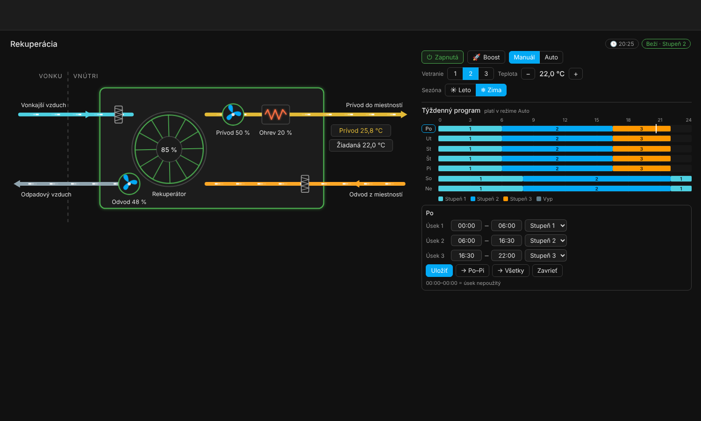

# Komfovent C4 – Modbus integration and dashboard card

Home Assistant setup for a Komfovent RECU-300VEB-R-EC-C4 ventilation unit (C4 controller)
connected over RS485 through a Waveshare RS485 TO POE ETH (B) gateway, with the wall panel
still connected.

## Files

| File | What it is |
| --- | --- |
| `komfovent_configuration.yaml` | `modbus`, `template`, `script` and `automation` blocks for `configuration.yaml`: sensors, switches, writable selects/numbers (template entities calling `modbus.write_register`), alarm notification and daily clock sync. |
| `komfovent-card.yaml` | Dashboard card using [`komfovent-card.js`](../../komfovent-card.js). |
| [`HOWTO.md`](HOWTO.md) | The whole process step by step: wiring, sniffing the bus, gateway settings, finding the Modbus ID, Home Assistant and the card. |
| `tools/` | `komfovent_sniffer.py` (passive bus sniffer), `komfovent_test.py` (ID scan and load test), `fake_c4.py` + `C4_registers.json` (C4 simulator over TCP or RTU). |

## Card installation

1. Copy `komfovent-card.js` from the repository root to `<config>/www/`.
2. Settings → Dashboards → ⋮ → **Resources** → add `/local/komfovent-card.js` as **JavaScript module**.
3. Reload the browser (Ctrl+F5) and add the card from `komfovent-card.yaml`.

The card draws the unit (outdoor air → filter → rotary heat exchanger → supply fan → heater → rooms,
extract → filter → heat exchanger → exhaust fan → outside) with animated air flow, and offers controls
for power, boost, ventilation level, setpoint, season and mode.

## Hardware notes (verified)

- J1 RJ45 on the unit (numbering as in the Komfovent drawing): pin 3 +20 V DC, pin 4 A, pin 5 B, pin 6 GND.
- Serial: 19200 8E1 (fixed). Modbus ID of the unit: **20** (register 1006). The wall panel polls ID 254
  (registers 10900–10909, once per second) – do not use 254 from Home Assistant.
- Register numbers in the C4 manual are 1-based; Home Assistant addresses are one lower (1000 → 999).
- Waveshare (VirCom): Transfer Protocol `Modbus_TCP Protocol`, Max Interval 3 ms,
  Modbus Gateway Type `Multi-host non-storage type`, **RS485 bus conflict detection 50 ms**.
  With the panel connected this gave 99.7 % successful reads.
- The gateway also forwards the panel's traffic; pymodbus skips it and logs
  `request ask for id=20 but got id=254`. Hide it with `logger: logs: pymodbus.logging: error`.
