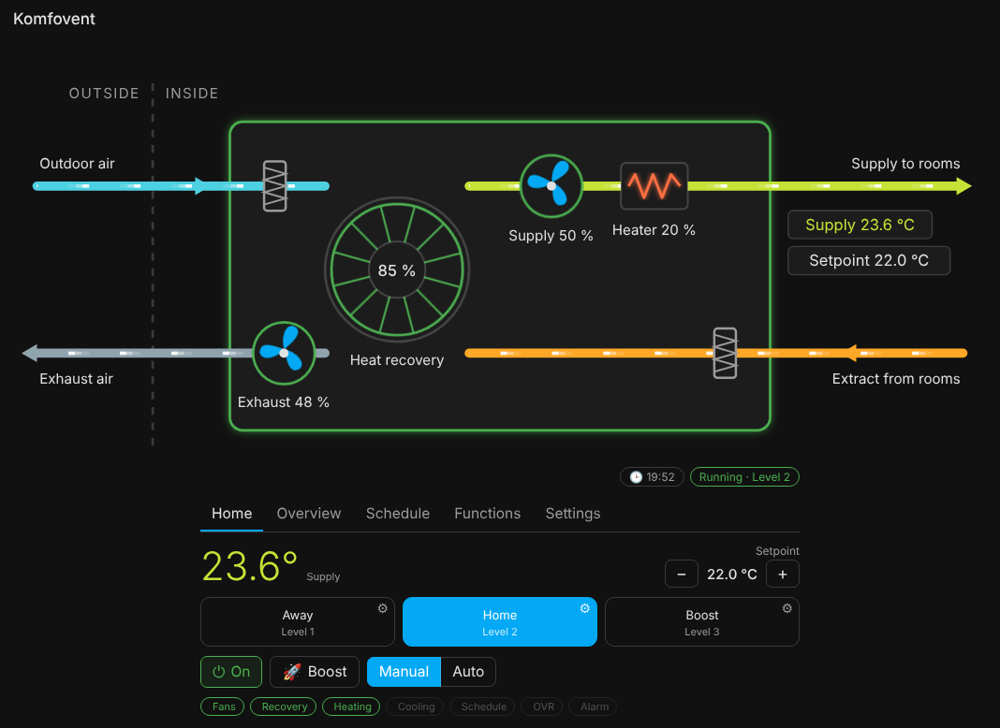

# Komfovent Card – rotary heat exchanger variant

An archived variant of the [Komfovent Card](../README.md#komfovent-card) for units with a **rotary heat exchanger** (wheel). It is the card as it was at version 1.3.0, before the main card was redrawn for a cross-counterflow plate exchanger with a bypass. It is kept so the idea is not lost and can be used on units with a rotor.



## What is different from the main card

| | Main card (`komfovent-card`) | This variant (`komfovent-card-rotary`) |
| --- | --- | --- |
| Heat exchanger | cross-counterflow plate exchanger, streams cross inside | rotary wheel spinning with the recovery level |
| Bypass | on/off summer bypass drawn above the exchanger | none (the rotor speed regulates recovery) |
| Duct layout | supply to rooms bottom right, extract from rooms top right | supply to rooms top right, extract from rooms bottom right |
| Version | current | frozen at 1.3.0 |

Control panel, weekly schedule, Functions and Settings tabs are the same as in card 1.3.0 and use the same entities and the same [`komfovent_configuration.yaml`](../komfovent_configuration.yaml).

## Files

| File | Language |
| --- | --- |
| `komfovent-card-rotary_sk.js` | always Slovak |
| `komfovent-card-rotary_en.js` | always English |
| `komfovent-card-rotary.js` | follows the Home Assistant language, or `language: sk` / `en` in the card |

Load exactly one of them. The variant has its own element name, so it can be loaded next to the main card without a conflict.

## Installation

1. Copy the chosen file to `<config>/www/`.
2. Settings → Dashboards → ⋮ → **Resources** → add `/local/komfovent-card-rotary_sk.js?v=1.3.0` as **JavaScript module**.
3. Reload the browser with Ctrl+F5.
4. Add the card:

```yaml
type: custom:komfovent-card-rotary
```

All options of the main card (`name`, `show_controls`, `show_schedule`, `modbus_hub`, `modbus_slave`, `language`, `entities:`) work the same way.

This variant is not developed further. Fixes and new features go to the main card.
